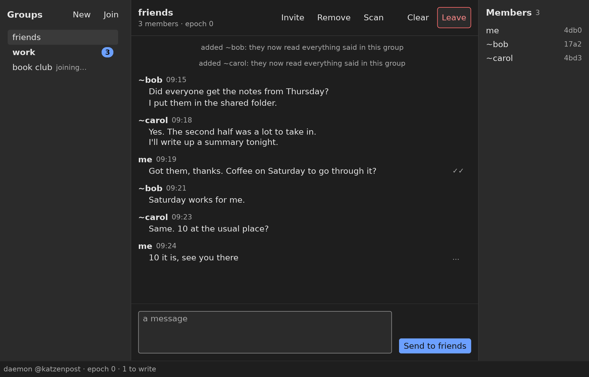

# Paw

*This library and its documentation were written by an AI agent, not a human.* It did a good job because it had a very inspiring GUI library to learn from: [monomer](https://github.com/fjvallarino/monomer), written in Haskell.

Paw is a GUI library for Lean in the Elm style: an app is a model, an `update` that handles messages, and a `view` that draws the model. It follows monomer's design of widgets, layout and merging a rebuilt view with the one on screen. Where a security rule can be stated as a proposition, Paw states it in a type: widgets prove they draw only inside their box, and effects such as opening a link need proof that the user chose the thing they act on. Lean can do this and Haskell cannot, because Lean has dependent types, and high-assurance software such as a GUI library should use them for its security properties.

It runs on Linux desktop, on X11 and Wayland, with a platform layer in Rust.

[glint](https://github.com/katzenpost/glint), a group chat over the Katzenpost mixnet, is written with Paw:



## Dependencies

Paw builds with Lean 4 (the version in `lean-toolchain`, from [elan](https://github.com/leanprover/elan)) and Rust (from [rustup](https://rustup.rs)). Lake builds the Rust crate in `rust/` with cargo and links it into each executable, so neither needs setting up by hand beyond installing the toolchains.

The Rust platform layer is built on these crates:

- [winit](https://github.com/rust-windowing/winit) opens windows and reads input on X11 and Wayland.
- [tiny-skia](https://github.com/RazrFalcon/tiny-skia) draws, and [softbuffer](https://github.com/rust-windowing/softbuffer) puts the drawn pixels on screen without a GPU.
- [cosmic-text](https://github.com/pop-os/cosmic-text) shapes and lays out text.
- [AccessKit](https://github.com/AccessKit/accesskit) exposes the widget tree to screen readers over AT-SPI.
- [arboard](https://github.com/1Password/arboard) reads and writes the clipboard.
- [image](https://github.com/image-rs/image) decodes PNG and JPEG.
- [lean-sys](https://github.com/katzenpost/lean-sys) gives Rust the Lean runtime's C API.

On the Lean side, [LeanBench](https://github.com/alok/LeanBench) runs the benchmarks.

The end-to-end tests (`make e2e`) drive the gallery as a user would and need more installed: Xvfb and xdotool for X11; sway, wtype and jq for Wayland; and `dbus-run-session`, the AT-SPI bus and Python's `gi` bindings for AT-SPI. With xclip and wl-clipboard installed they also check the clipboard. `make ci` runs everything, end-to-end tests included.

## Try it

```
make demo
```

builds and runs the gallery, an example with every widget Paw has. Its code is in `examples/Gallery.lean`.

`make` runs the tests, the coverage check and the golden images.

## Documents

Written as prose, in `docs/`:

- [DESIGN.md](docs/DESIGN.md): how Paw is built, what it keeps from monomer and what it changes, and the laws its types carry.
- [GUI_SECURITY_GUIDELINES.md](docs/GUI_SECURITY_GUIDELINES.md): the security rules for GUI applications that Paw enforces.

Generated from the code:

- [API docs](https://katzenpost.github.io/paw/): every public definition with its docstring, built by doc-gen4 and published from `main`. `make docs` builds them locally.
